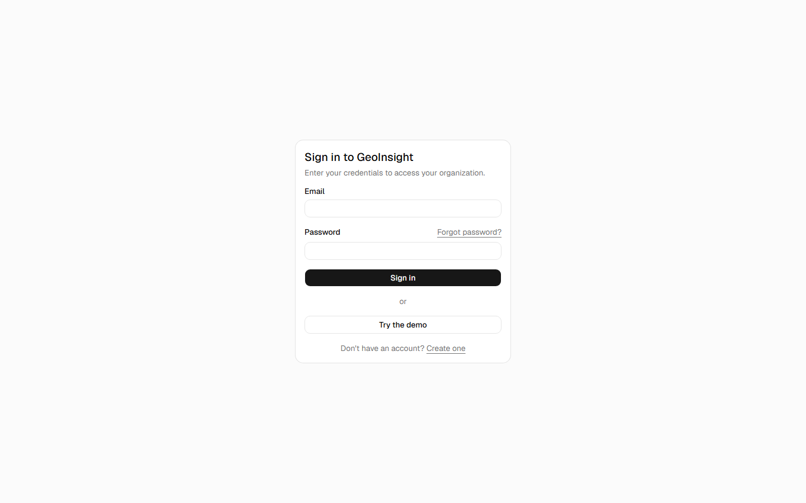
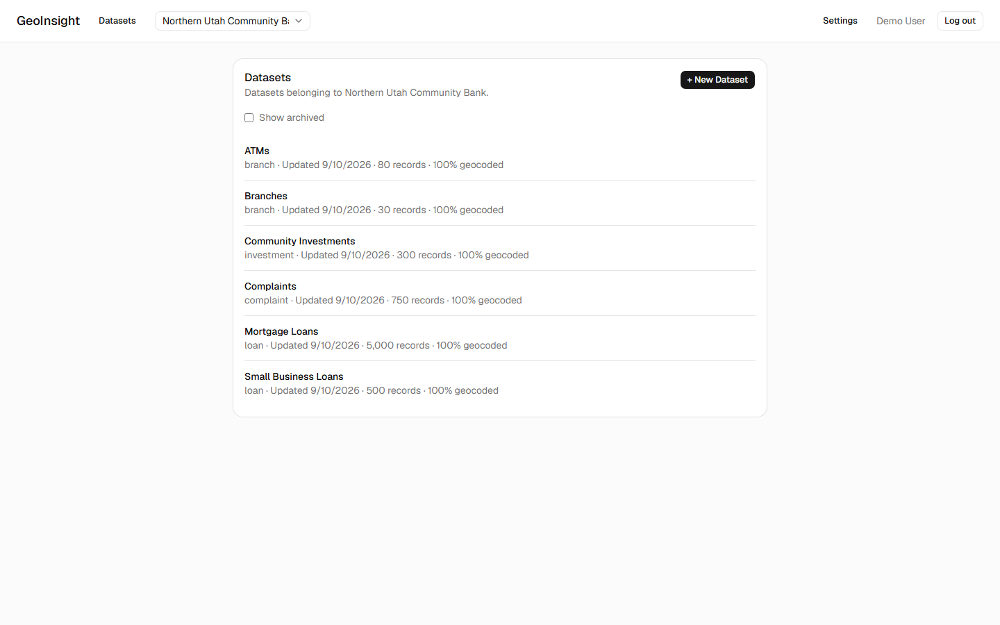
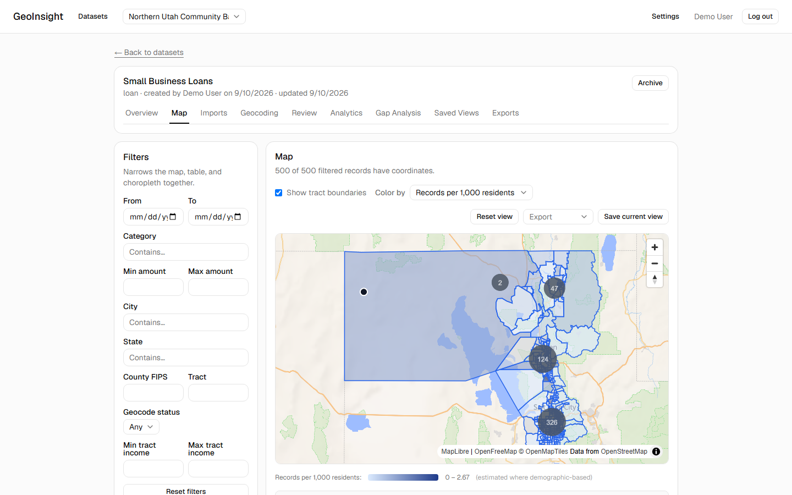
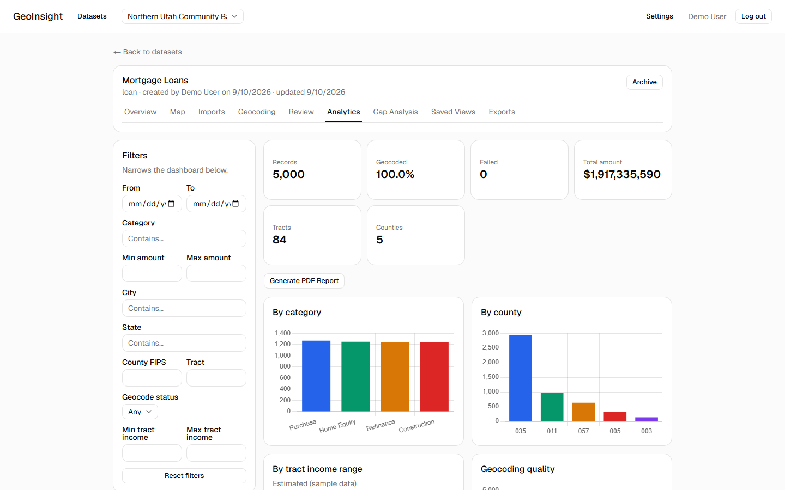
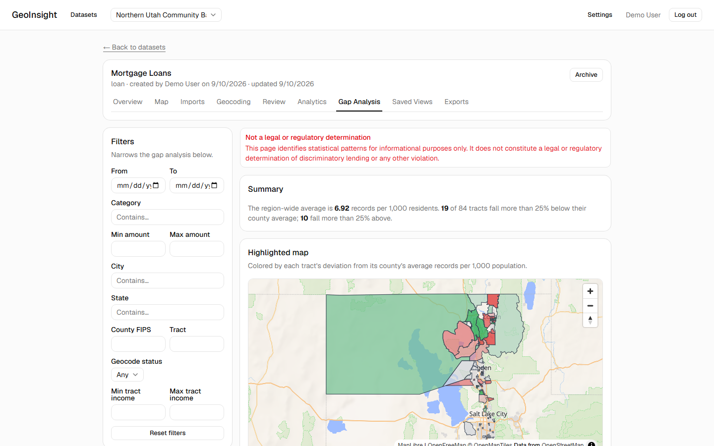
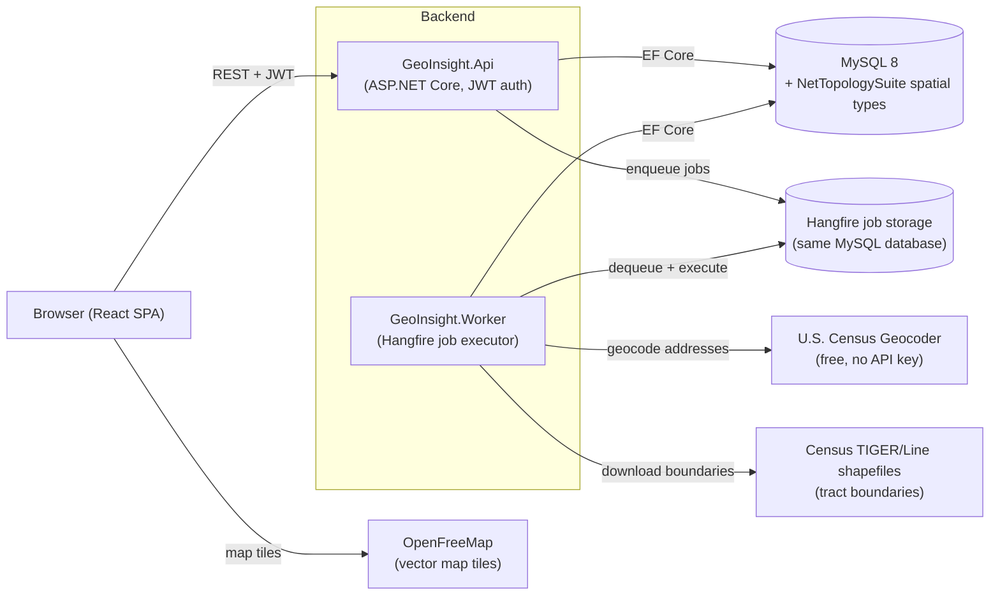

# GeoInsight

A portfolio-quality SaaS application for bulk geocoding, Census demographic enrichment, and interactive geographic analysis.

The current build includes repo/Docker/DB scaffolding, authentication and organizations (with role enforcement, plus password reset), dataset CRUD, CSV import (upload → preview → column mapping → validation → commit), an interactive MapLibre map with clustering and table sync, background geocoding against the U.S. Census Geocoder (Hangfire job queue + a dedicated `GeoInsight.Worker` process), an Address Review Queue for resolving the failed/ambiguous records that geocoding leaves behind, real Census tract boundary polygons (spatial import + point-in-polygon assignment + a toggleable map layer), tract-level demographic figures on click, a filter sidebar with server-side filtering plus choropleth map coloring that all stay in sync, an Analytics Dashboard (summary cards, Chart.js charts, and a geographic analysis table, all recalculating together from the same active filter), Saved Views (bookmark a filter/map-position/tract/choropleth state, reload/rename/duplicate/delete it later), Exports (CSV/XLSX/GeoJSON data exports respecting active filters, a PNG map image, and a full PDF report bundling summary/charts/a live map snapshot/geographic statistics), centralized Audit Logging (dataset/import/geocoding/export/role-change/saved-view actions, viewable as an Administrator-only Audit History on Organization Settings), Geographic Gap Analysis (a sortable tract table comparing each tract's records-per-1,000-population against its county average, a diverging-color highlighted map, and explanatory statistics — explicitly framed as an indicator, not a legal or regulatory determination), and a portfolio-polish pass with loading/error/empty states, a responsive layout, a seeded "Northern Utah Community Bank" demo org, a Playwright E2E suite, and CI.

> **Note on demographic data**: the population/income/poverty/age figures shown when you click a Census tract are **synthetic placeholder values**, not real Census statistics — the real ACS Data API requires a free API key that isn't configured here (see "Architecture decisions" below). Every place these numbers appear is labeled "Estimated (sample data)."

## Screenshots

A seeded demo organization ("Northern Utah Community Bank," 6,660 records across 6 datasets) is what's shown below. Sign in with the "Try the demo" button on the login page to explore it yourself.

| | |
|---|---|
|  |  |
| Login — including password reset | Dataset list, with record count / geocoded % |
|  |  |
| Interactive map: clustering, filters, tract choropleth | Analytics dashboard: summary, charts, PDF export |
|  | |
| Geographic Gap Analysis: diverging highlighted map | |

## Architecture



`GeoInsight.Api` only ever *enqueues* Hangfire jobs (geocoding, tract import); `GeoInsight.Worker` is the only process that actually executes them, so a slow external API call never blocks an HTTP request. Both talk to the same MySQL database — Hangfire's own job-storage tables live there too, rather than in a separate queue service. See "Architecture decisions" below for why each of these choices was made.

## Project structure

```text
GeoInsight/
  docker-compose.yml   frontend + api + mysql
  sample-data/         Demo CSVs for the import wizard (one with coordinates, for the map;
                       one comprehensive 36-row/5-county CSV exercising every phase's features;
                       6 demo-*.csv files — the seeded "Northern Utah Community Bank" scenario)
  docs/screenshots/    README screenshots
  backend/
    GeoInsight.slnx
    src/
      GeoInsight.Domain          Entities/enums, no framework dependencies
      GeoInsight.Application     DTOs and service interfaces (IAuthService, ...)
      GeoInsight.Infrastructure  EF Core DbContext, Identity, JWT, migrations, geocoding, Hangfire, tracts (NTS/spatial)
      GeoInsight.Api             Controllers, Program.cs, Swagger, Hangfire dashboard (Dev only)
      GeoInsight.Worker          Background job executor — runs geocode jobs (AddHangfireServer)
    tests/
      GeoInsight.Tests           xUnit
  frontend/
    src/
      api/            fetch client + typed calls per endpoint
      auth/           auth context + route guard
      organizations/  role-permission helpers, last-visited-org storage
      pages/          Login, Register, org/dataset/import/analytics/exports pages
      components/     RecordFilterSidebar (shared by the Map and Analytics pages) + ui/ (shadcn/ui primitives)
      lib/            mapStyle.ts (shared MapLibre style URL) + utils.ts
```

## Prerequisites

- [.NET 10 SDK](https://dotnet.microsoft.com/download)
- [Node.js 22+](https://nodejs.org/)
- [Docker Desktop](https://www.docker.com/products/docker-desktop/) (for the `docker compose` path)
- A local MySQL 8 server, if you'd rather run without Docker

## Configuration

Copy the environment templates and fill in real values:

```bash
cp .env.example .env
cp frontend/.env.example frontend/.env
```

`.env` (repo root) is consumed by `docker-compose.yml`. `frontend/.env` is consumed by Vite when running the frontend outside Docker.

Uploaded CSV files are written to disk (`Storage:UploadsRoot` in `appsettings.json`, defaulting to a local `uploads/` folder next to the API — gitignored). Under Docker Compose this is a named volume (`api-uploads`) instead so files survive container restarts.

## Running — Docker Compose (once Docker Desktop is installed)

```bash
docker compose up --build
```

This starts `mysql`, `api` (port 8080), `worker` (no exposed port — it only processes background jobs), and `frontend` (port 5173). Docker Compose sets `Database__AutoMigrate=true`, so the API applies pending EF Core migrations on startup and a fresh Compose database is ready to use without a separate migration command.

**Geocoding requires the `worker` container to be running** — the `api` container only enqueues geocode jobs (`AddHangfire()`, no `AddHangfireServer()`), it never executes them itself, so a job left running with the API alone will sit at `Queued` forever.

## Running — local dev (no Docker)

1. Start a local MySQL 8 instance and create a database/user matching your `.env`:

   ```sql
   CREATE DATABASE IF NOT EXISTS geoinsight CHARACTER SET utf8mb4 COLLATE utf8mb4_0900_ai_ci;
   CREATE USER IF NOT EXISTS 'geoinsight'@'localhost' IDENTIFIED BY 'changeme';
   GRANT ALL PRIVILEGES ON geoinsight.* TO 'geoinsight'@'localhost';
   FLUSH PRIVILEGES;
   ```

2. Backend:

   ```bash
   cd backend
   dotnet user-secrets init --project src/GeoInsight.Api   # only needed once — sets UserSecretsId in the .csproj
   dotnet user-secrets set "ConnectionStrings:Default" "Server=localhost;Port=3306;Database=geoinsight;User=geoinsight;Password=changeme;" --project src/GeoInsight.Api
   dotnet ef database update --project src/GeoInsight.Infrastructure --startup-project src/GeoInsight.Api
   dotnet run --project src/GeoInsight.Api
   ```

   The API listens on `http://localhost:5035` (see `backend/src/GeoInsight.Api/Properties/launchSettings.json`). Swagger UI is at `/swagger` in Development, and the Hangfire dashboard (job queue/history) is at `/hangfire`, also Development-only.

3. Worker (**required for geocoding to actually run** — the API only enqueues jobs, it never executes them):

   ```bash
   cd backend
   dotnet run --project src/GeoInsight.Worker
   ```

   No ports to configure — `appsettings.json` already has the same default local connection string as the API, so it should start cleanly against the same database (its own `UserSecretsId` is there if you need to override it, e.g. for a non-default password). It polls the shared Hangfire storage for work; without it running, a geocode job started from the UI will stay `Queued` indefinitely.

4. Frontend:

   ```bash
   cd frontend
   npm install
   npm run dev
   ```

   Vite serves on `http://localhost:5173` and expects `VITE_API_URL=http://localhost:5035` (already the default if `frontend/.env` is unset).

## Migrations

The `dotnet-ef` CLI tool is required (pinned to match the EF Core version used here):

```bash
dotnet tool install --global dotnet-ef --version 9.0.19
```

Add a new migration:

```bash
dotnet ef migrations add <Name> \
  --project backend/src/GeoInsight.Infrastructure \
  --startup-project backend/src/GeoInsight.Api \
  --output-dir Persistence/Migrations
```

Apply migrations to whatever `ConnectionStrings:Default` currently points at:

```bash
dotnet ef database update \
  --project backend/src/GeoInsight.Infrastructure \
  --startup-project backend/src/GeoInsight.Api
```

Migration generation does **not** require a live database connection — see "Architecture decisions" below.

## Tests

```bash
cd backend
dotnet test
```

Covers the `/health` endpoint, the EF Core model (via the InMemory provider, standing in for a live-MySQL integration test), organization/dataset/import/geocoding/review/tract-import/analytics/saved-view/export/audit-event service logic (including cross-organization access-denial and IDOR checks), CSV row-validation rules, the Census geocoding response parser (against real captured-response fixtures — including a real ambiguous 2-candidate response — no live network call in the suite), the geocode job runner (fake `IGeocodingService`, real `Hangfire.MemoryStorage`, including its own terminal-failure path and the audit event it logs), the tract import runner (fake `IStateTractSource` with hand-built polygons — no live shapefile download in the suite — verifying MultiPolygon/SRID normalization and point-in-polygon backfill), the placeholder demographic generator (determinism, value ranges, owner+renter summing to 100%), the shared record-filter query logic (every filterable field, in isolation and combined) and the choropleth's demographic-vs-record-derived metric split, the analytics aggregation logic (summary math, category/county/status/income-range/time-series breakdowns, tract statistics including county/region average comparison and deviation math, and filter-recalculation), the saved-view service (JSON round-tripping, ownership-vs-Administrator rename/delete gating), the export service (CSV/XLSX/GeoJSON generation respecting filters, byte-exact Png/Pdf round-tripping through real disk storage via a temp-directory-backed `LocalFileStorageService`, Analyst-vs-Viewer gating), the audit event read service (pagination, newest-first ordering, Administrator-only access), and full HTTP-level flows through the real JWT/JSON/multipart pipeline (`*ApiTests`, via `TestApiFactory`, which swaps Hangfire's storage, `IGeocodingService`, and `IStateTractSource` for test-controllable fakes, alongside its existing EF Core InMemory swap).

## End-to-end tests (Playwright)

```bash
cd frontend
npm run test:e2e
```

Assumes the backend (MySQL + API + Worker) is already running (see "Running — local dev" above) and drives a real Chromium browser against it — `auth.spec.ts` covers register/logout/login and the full forgot-password → reset → auto-sign-in flow; `dataset-flow.spec.ts` covers the whole core loop in one pass: register → create organization → create dataset → upload/map/validate/commit a CSV → run a **real** geocode job against the live Census Geocoder → confirm the point appears on the map → apply a filter that excludes it (exercising the "no records match the current filters" empty state) → confirm the numbers show up correctly on the Analytics dashboard. Because it hits a real external service, it's slower and slightly less deterministic than the backend's fixture-based tests — see "Architecture decisions" below for why that trade-off was accepted here rather than mocked.

## Architecture decisions

- **Auth**: ASP.NET Core Identity (`IdentityUserContext<ApplicationUser, long>` — the roles-free variant) for user storage and password hashing, plus hand-issued JWT bearer tokens for the SPA to call the API with. Organization-level roles (Administrator/Analyst/Viewer) live in `organization_users.role`, not in Identity's role tables, since a user's role is scoped to an organization rather than global.
- **Layered backend**: `Domain` has no framework dependencies (not even Identity — `ApplicationUser` lives in `Infrastructure` because it extends `IdentityUser<long>`). `Application` defines DTOs and interfaces; `Infrastructure` implements them against EF Core/Identity/JWT. This is more structure than Phase 0 strictly needs, but Phase 2 onward adds dataset/geocoding/Census services that need exactly this separation, so it's set up once rather than retrofitted.
- **Hangfire, not Quartz.NET, for background geocoding jobs** — its storage doubles as persistence/retry/dashboard with no extra scheduling abstraction needed for "run this job, track its progress"; Quartz.NET's strength (cron-style recurring schedules) isn't needed here. `GeoInsight.Api` only enqueues jobs (`AddHangfire()`); `GeoInsight.Worker`, a plain generic-host console app, is the only process that calls `AddHangfireServer()` and actually executes them — this keeps the HTTP request path non-blocking. A geocode job only ever claims records with `geocode_status IN ('pending', 'processing')`, which gives duplicate-avoidance and resume-after-crash/-cancel for free.
- **MySQL 8 + Pomelo, pinned to EF Core 9.0.19.** Pomelo.EntityFrameworkCore.MySql has not shipped an EF Core 10–compatible release yet (latest is `9.0.0`, targeting EF Core 9), so every EF Core package here is pinned to `9.0.19` even though the projects target `net10.0`. Revisit this once Pomelo catches up.
- **Hardcoded `MySqlServerVersion`** (not `ServerVersion.AutoDetect`) in `GeoInsight.Infrastructure/DependencyInjection.cs` — this is what lets `dotnet ef migrations add` run without a live MySQL connection, which mattered a lot while scaffolding this without Docker/MySQL available.
- **shadcn/ui (Nova preset) + Tailwind v4 + React Hook Form + Zod** for the frontend, per the chosen UI direction.
- **Org-scoped, not header-scoped, routing.** Every resource nests under `/api/organizations/{organizationId}/...` (datasets, imports) rather than using a session/header concept of "current organization" — the frontend's "current org" is purely a URL concept (`/organizations/:organizationId/...`).
- **`OrganizationAccessControl`** is the one place membership/role checks happen (`org missing → 404`, `not a member → 403`, `role too low → 403`), reused by every org-scoped service via `OrganizationRoleExtensions.MeetsMinimum`. `ServiceResult<T>` (`Application/Common/`) is the shared success/error-with-status-code result type services return.
- **CSV import** is upload → preview → column-mapping → validate → commit, with column mappings held client-side and resent to `validate`/`commit` rather than persisted server-side (`ImportService.ProcessFileAsync(..., commit: bool)` shares the parsing/validation logic between those two calls). Archiving a dataset is a reversible soft-delete (`IsArchived`/`ArchivedAt`), not a hard `DELETE`.
- **The map needs `optimizeDeps.exclude: ['maplibre-gl']`** in `frontend/vite.config.ts` — without it, Vite's dependency pre-bundling breaks MapLibre's internal worker script and the map silently renders blank (no console error). If you ever see a blank map after touching frontend build config, check this first.
- **Geocoding (Phase 5)** calls the free, no-API-key U.S. Census Geocoder (`geocoding.geo.census.gov`) — one request returns both coordinates and Census tract/block geography, so there's no separate geography lookup. 0 matches → `failed`; exactly 1 → `matched`; 2+ → `ambiguous`, with all candidates stored for the Address Review Queue. A CSV can still supply `latitude`/`longitude` columns directly during import as an alternative (sets `geocode_status = "matched"`, `geocoder_source = "csv_import"`) — `sample-data/2026-mortgage-loans-with-coordinates.csv` has real coordinates for exactly this.
- **Address Review Queue (Phase 6)** resolves `failed`/`ambiguous` records three ways — accept one of the stored Census candidates, correct the address (re-geocoded synchronously, inline in the HTTP request, not a background job), or type coordinates directly — all landing on `geocode_status = "manually_resolved"` to stay distinct from the automatic job's `matched`. "Mark unresolved" doesn't add an 8th status; `DatasetRecord.ReviewDismissedAt` just removes a record from the active queue. A small generic `audit_events` table (`IAuditService`) logs every one of these actions.
- **`GeocodeResultApplier`** (`Infrastructure/Geocoding/`) is the single place a `GeocodeResult` gets mapped onto a `DatasetRecord`'s geocode fields — shared by the automatic job runner and the review queue's manual actions so that mapping isn't duplicated between an automatic and a human-driven path.
- **Census tracts (Phase 7)** import real U.S. Census TIGER/Line shapefiles via `NetTopologySuite.IO.ShapeFile` + `Pomelo.EntityFrameworkCore.MySql.NetTopologySuite` (`census_tracts.boundary` is a real `MULTIPOLYGON SRID 4326` with a MySQL spatial index). Scoped on-demand per dataset (only the counties its own geocoded records reference, not a nationwide preload) and run as a Hangfire job like geocoding — but with no `TractImportJob` tracking table, since import status is just "does `census_tracts` already have rows for the needed counties," recomputed live rather than persisted. Point-in-polygon tract assignment (in-memory NTS `Contains()`, not a SQL-translated `ST_Contains`) backfills only the manually-entered-coordinate records Phase 6 left without a tract — automatically-geocoded records already have theirs from the Census Geocoder directly.
- **TIGER shapefile quirks**: each tract parses as a `Polygon`, not `MultiPolygon` (normalized at import time), and comes back with `SRID=0` (set to 4326 explicitly — never auto-populated). No county/state name fields exist in the shapefile itself, only FIPS codes.
- **Demographic data (Phase 8) is synthetic, not real — the one deliberate exception to this project's "real live data everywhere" pattern.** The real Census ACS Data API requires a free API key (confirmed live via `curl` — unlike the geocoder and TIGER shapefiles, it returns `X-DataWebAPI-KeyError` and redirects to a missing-key page with none supplied); rather than obtain one, the user chose to skip the real integration. `IDemographicDataSource` (`Application/Tracts/`) is the swap point — the only implementation today, `PlaceholderDemographicDataSource`, generates deterministic values seeded by each tract's GEOID (same tract always gets the same numbers). A real `AcsDemographicDataSource` could implement the same interface later with no changes to any caller, DTO, or DB column. Generation runs as a synchronous extra step inside the existing Phase 7 tract-import job (no new background job), and the figures ride along on the existing `GET .../tracts` response rather than a second endpoint. Every UI surface showing these numbers is labeled "Estimated (sample data)."
- **Filtering and choropleths (Phase 9) share one filter shape everywhere.** `RecordFilterRequest` (`Application/Common/`) plus `RecordFilterQueryExtensions.ApplyFilters` (`Infrastructure/Records/`) is the single place every filterable field is translated to SQL, used by the paged table, the map points endpoint, the choropleth's record-derived metrics, and (Phase 10) the analytics endpoint — the acceptance criterion ("filtering changes all visualizations consistently") holds structurally, not by convention. The choropleth is its own endpoint (`GET .../tracts/choropleth?metric=...`) rather than a bigger boundaries response: demographic metrics (population, income, poverty, minority %) come straight from `census_demographics` untouched by the filter, while record-derived metrics (count, total/average amount, records-per-1,000) aggregate the *filtered* records grouped by tract — that split is what makes filtering visibly affect tract colors. Fixed a latent pagination bug while wiring this in: `GetPagedAsync`'s `totalCount` had been computed from an unfiltered query all along, harmless until a filter could exist to diverge from it.
- **Analytics Dashboard (Phase 10) is one `GET .../analytics` endpoint**, not six — summary cards, all five chart datasets, and the tract statistics table are computed from a single filtered snapshot of the dataset's records (the same `ApplyFilters` from Phase 9), so "recalculates based on filters" holds by construction rather than needing several requests to agree. Charts render via Chart.js (`chart.js/auto`, exactly one transitive dependency) through a direct `ref`+`useEffect` integration, the same imperative pattern already used for MapLibre, rather than adding a React-wrapper charting library. The filter form itself (`RecordFilterSidebar`) was extracted out of the Map page into a shared component once the Analytics page needed the identical fields — the two pages each keep independent filter state; sharing that state across pages is explicitly Phase 11's job.
- **Saved Views (Phase 11) split across two surfaces.** `saved_views` stores `filters` and `map_configuration` as JSON. It is written to from a lightweight "Save current view" button on the Map tab (the only page with tract-toggle/choropleth state to save) and managed from a dedicated "Saved Views" tab (`SavedViewsPage.tsx`) with Open/Rename/Duplicate/Delete rather than cramming full CRUD into the Map page. Any org member (Viewer+) can create/open their own views — they're personal bookmarks, not dataset-mutating actions — but renaming/deleting someone *else's* view needs Administrator, re-checked fresh on every call (no stale-permission window). "Open" is a plain `.../map?view={id}` link; the Map page applies it once via a new `resetSignal` prop on `RecordFilterSidebar`, the minimal change needed to push external state into what had been a purely self-contained form.
- **Exports (Phase 12) has one `POST .../exports` endpoint for all 5 formats, no Hangfire job.** Every format finishes inside one HTTP request — CSV (CsvHelper, already a dependency)/XLSX (new: ClosedXML)/GeoJSON (`System.Text.Json`) are generated server-side from the same Phase 9 `RecordFilterQueryExtensions.ApplyFilters` every other read endpoint uses; PNG/PDF only exist as rendered browser pixels (MapLibre/Chart.js canvases), so the client renders them and the server just persists the given base64 bytes via the existing `IFileStorageService`. Export requires Analyst+ to create but Viewer+ to list/download. The PDF report is assembled client-side with jsPDF on the Analytics tab and includes a genuine map image — captured from a temporary, off-screen MapLibre instance created just for the snapshot, since the Map and Analytics tabs are different routes and can't share a live map instance. Building the report surfaced a real Phase 10 bug: the "Geographic analysis" table was listing every tract in a dataset's touched *counties* rather than tracts its records actually touch (415 rows, mostly zero-activity, for a dataset spanning populous Salt Lake County) — fixed to match `Summary.TractCount`'s definition.

- **Audit Logging (Phase 13) adds call sites, not infrastructure** — `audit_events`/`IAuditService` already existed from Phase 6 with an explicit "more call sites is Phase 13" comment. Seven more actions now log through the identical `Log(...)` call the Review Queue established: dataset creation, import commit, geocoding start/completion, export creation, organization role changes, and saved-view creation. Geocoding start and completion are logged from two different services deliberately — "start" is the HTTP-request-scoped `GeocodeJobService.CreateAsync` (full org/user context in hand), "completion" is the Hangfire background job `GeocodeJobRunner.RunAsync` (no request-scoped user, so it looks up the organization from the dataset and attributes the event to whoever originally queued the job). Login is deliberately *not* logged — `audit_events.organization_id` is `NOT NULL` by design, but login has no organization context (a user may belong to zero or several orgs), and `AuthService` doesn't even hold a `GeoInsightDbContext` today. The read side (`IAuditEventService`, `GET .../audit-events`, Administrator-only per the PRD's role table) and its UI (a paginated "Audit History" card on Organization Settings) are new.

- **Geographic Gap Analysis (Phase 14) extends Phase 10's tract-statistics computation rather than adding a second one.** `AnalyticsService.BuildTractStatistics`'s `TractStatisticDto` gained `AverageAmount`, `CountyFips`, `CountyAverageRecordsPer1000`, `RegionAverageRecordsPer1000`, and `DeviationFromCountyAveragePercent` — the same `/analytics` endpoint every tab already calls, so Analytics' own table gets these columns too. Only records-per-1,000-population (the standard population-normalized coverage indicator) is run through the comparison math; deviation is computed against each tract's *county* average specifically (the tighter peer group), with the region average still shown for context. A flat ±25% deviation is the "notably below/above" cutoff — simple and explainable, not a statistical z-score, which would overstate precision given the underlying population figures are already synthetic (Phase 8). The new "Gap Analysis" tab adds real client-side table sorting, a second interactive MapLibre instance with a *diverging* color scale centered on 0% deviation (distinct from Phase 9's sequential choropleth gradient), and a persistent disclaimer stating this is analysis, not a legal or regulatory determination — required by the PRD, not optional polish.

- **Portfolio Polish (Phase 15) started with a retrospective audit, not just a fixed checklist.** That pass surfaced six real, previously-unflagged gaps: password reset (real Identity tokens; no email service exists, so the reset link is shown in-app instead — documented, not hidden), dataset-list record-count/geocoded-% columns, Saved Views' map center/zoom, a map "Reset view" control, a Docker build bug (`GeoInsight.sln` referenced in both Dockerfiles when only `GeoInsight.slnx` exists), and one reviewed-and-rejected non-issue (a per-record "dataset type" filter doesn't apply — `RecordFilterSidebar` is always scoped inside one already-selected dataset). **Two real regressions were caught by actually running the app, not just by tests passing**: wiring up password-reset tokens crashed `GeoInsight.Worker` (missing `AddDataProtection()` outside the Api's web host — Identity's token provider needs it, and only the Api gets one implicitly); and seeding the demo org (below) surfaced a genuine pre-existing gap where a dataset built entirely from CSV-supplied coordinates could never get Census tract data through any UI path, since the point-in-polygon backfill only ever ran as a side effect of a tract-import job that itself only triggers for counties a *live-geocoded* record had already established — fixed with a new `BackfillOnlyAsync` path matching such records against every already-imported tract with no county to scope by. The seeded demo org ("Northern Utah Community Bank," 6,660 records across 6 datasets) was generated by a throwaway Node+turf script sampling real points-in-polygon from already-imported tract boundaries — restricted to a fixed "hot tract" subset per county after a first pass spread records uniformly across 400+ tracts and produced an unusably long analytics table, a good reminder that realistic-looking synthetic data needs deliberate clustering, not just correct geometry. A responsive-layout pass driven by a scripted `scrollWidth`-vs-`clientWidth` check (not eyeballing) at 375/768/1280px found two structural overflow bugs (an unwrapped header, and a `min-width: auto` CSS Grid default not shrinking a sidebar+content layout at exactly 768px) rather than anything cosmetic. The Playwright E2E suite added here is real, not aspirational — see "End-to-end tests" above.

## What's next

Potential follow-up work includes replacing the synthetic demographic data source with real ACS API calls, adding email delivery for password reset links, and experimenting with an optional natural-language "Ask GeoInsight" assistant for saved views and analytics questions.
